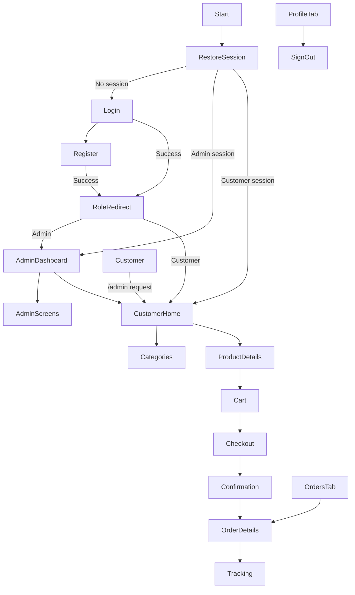

# D&G E-Commerce Mobile App

A cross-platform Expo, React Native, and TypeScript storefront for D&G in Rwanda. It loads its catalog and account data from the configured backend and includes search and category/price filters, a backend-synchronized cart, checkout, order tracking, an admin console, and English, Kinyarwanda, and French localization.

## Requirements

- Node.js compatible with Expo SDK 58
- npm
- An API implementing the contract below (authentication, account-only routes, and checkout require it)
- Expo Go or a development build for a device; web is supported for UI development

## Installation and run

```powershell
npm install
Copy-Item .env.example .env
```

Set `EXPO_PUBLIC_API_URL` to the backend API URL and `EXPO_PUBLIC_SERVER_URL` to the backend origin used to load uploaded images. The sample values target this development machine at `172.23.71.218:3000`; update them if the machine IP or backend port changes. A physical phone running Expo Go must use the computer's LAN IP (not `localhost`) and be able to reach the backend over the same network. Confirm the backend listens on the LAN interface and that the firewall allows its port. Android emulators commonly reach the host through `10.0.2.2`. Restart Expo after changing `.env`. Do not put private keys or server secrets in an `EXPO_PUBLIC_` variable; these values are bundled into the client.

```powershell
npx expo start
```

Use `npx expo start --android`, `npx expo start --ios`, or `npx expo start --web` to select a platform. The app uses the Expo Router tabs and native-safe AsyncStorage module. Native projects are generated by Expo; do not hand-edit generated `ios/` or `android/` folders.

## Dependencies

| Package | Purpose |
| --- | --- |
| `expo`, `expo-router` | Expo runtime and file-based navigation |
| `react-native`, `react` | Cross-platform UI |
| `@reduxjs/toolkit`, `react-redux` | Typed app state and async actions |
| `axios` | REST client and request/response interceptors |
| `@react-native-async-storage/async-storage` | Persisted session and language preference |
| `formik`, `yup` | Form state and validation |
| `i18next`, `react-i18next` | English, Kinyarwanda, and French localization |
| `expo-image`, `expo-status-bar` | Image and status bar support |

## Project structure

```text
src/
├── api/                 # Axios client and typed auth/product/cart/order services
├── app/                 # Expo Router screens and tab layout
│   ├── (tabs)/          # Authenticated customer home, categories, cart, orders, profile
│   ├── admin/           # Role-protected dashboard, product, user, order, and review management
│   ├── login.tsx
│   ├── register.tsx
│   ├── checkout.tsx
│   ├── product/[id].tsx
│   ├── order/[id].tsx
│   └── tracking/[id].tsx
├── components/          # Product card, auth gates, order timeline, and UI primitives
├── constants/           # Theme and color tokens
├── redux/               # Store, typed hooks, and auth/product/cart/order slices
├── services/            # AsyncStorage session persistence
├── translations/        # English, Kinyarwanda, and French resources
├── utils/               # RWF formatting
└── types/               # Shared domain and CSS module types
```

## API integration

The local `.env.example` contains both public endpoints for Expo Go on the current development network. Copy it to `.env` and update the LAN host or port when needed. `src/config/api.ts` is the single source for the API base URL and media server URL; the application does not fall back to `localhost`.

The base URL is `EXPO_PUBLIC_API_URL`; the client uses a 15-second timeout and adds a stored JWT as a Bearer token. A 401 clears the saved session and dispatches logout. Network errors, timeouts, and server errors are surfaced to the screens.

The app reuses its typed `authService`, `productService`, `cartService`, `orderService`, `adminService`, `reviewService`, `wishlistService`, and `notificationService` modules. The app expects these endpoints and response shapes:

| Method | Endpoint | Expected response |
| --- | --- | --- |
| `POST` | `/auth/login` | `{ "user": { "id": "...", "name": "...", "email": "..." }, "token": "..." }` |
| `POST` | `/auth/register` | Same session response |
| `POST` | `/auth/forgot-password` | Success response; body `{ "email": "..." }` |
| `GET` | `/products` | `Product[]` (the client also accepts a paginated `{ "items": Product[] }` response); accepts `search`, `category`, `minPrice`, `maxPrice` query parameters |
| `GET` | `/products/:id` | One `Product` |
| `PUT` | `/cart` | Accepts `{ "items": CartItem[] }` |
| `DELETE` | `/cart` | Clears the server cart |
| `POST` | `/orders` | Accepts `{ "items": CartItem[], "address": ShippingAddress, "paymentMethod": PaymentMethod }`; returns an `Order` with server-calculated total/status |
| `GET` | `/orders` | `Order[]` for the authenticated customer |
| `GET` | `/orders/:id` | One authorized `Order` |

Product, order, address, payment, and session fields are defined in `src/types/index.ts`. The catalog starts empty and is populated only from the backend; API failures are surfaced rather than replaced with demonstration data. Authentication, cart synchronization, and placing orders require the configured service.

## Version 2 features

Version 2 is additive: the existing authentication, cart, order, inventory, and Swagger endpoints remain available. New storage is added for reviews, wishlist items, notifications, and product views. The backend creates these models during startup; `backend/database/schema.sql` also contains their SQL definitions for explicit database setup.

The mobile app uses these new endpoints under `/api/v2`:

| Method | Endpoint | Purpose |
| --- | --- | --- |
| `GET` | `/v2/products`, `/v2/products/:id` | Product data with published review averages and counts |
| `GET` | `/v2/products/suggestions?q=...` | Search product name, category, and description |
| `POST` | `/v2/products/:id/views` | Record a product view for analytics |
| `GET`, `POST` | `/v2/products/:id/reviews` | Read published reviews and submit a purchased-product review |
| `GET` | `/v2/reviews/me` | Customer's recent reviews |
| `GET`, `POST`, `DELETE` | `/v2/wishlist` | View, add, and remove customer wishlist items |
| `GET` | `/v2/notifications` | List notifications for the signed-in user |
| `PATCH` | `/v2/notifications/:id/read`, `/v2/notifications/read-all` | Mark one or all notifications read |
| `GET` | `/v2/admin/reviews?status=...` | Filter and moderate reviews |
| `PATCH`, `DELETE` | `/v2/admin/reviews/:id/approve`, `/v2/admin/reviews/:id` | Approve or remove a review |
| `GET` | `/v2/admin/analytics` | Selling, views, review, stock, monthly order, and revenue metrics |

Review creation requires an authenticated customer with the product in their order history, and one review per customer/product is allowed. New reviews are pending until an administrator approves them; only approved reviews contribute to public ratings. Order creation/status changes, wishlist-related restocks, and review approval create persistent notifications. The notification and profile screens refresh unread counts periodically. Customer wishlist and notification pages are available from the customer navigation; review moderation and analytics are on the admin dashboard.

## State management

- `authSlice`: session restore, registration, login, logout, and visible errors. JWT sessions are stored in AsyncStorage.
- `productSlice`: catalog, refresh loading/error, and shared category/price filters.
- `cartSlice`: quantities, stock limits, removal, clearing, backend synchronization state, item count, and subtotal selectors.
- `orderSlice`: authenticated order history and order placement states.

Components use typed `useAppDispatch` and `useAppSelector` hooks. Order totals and final prices must be recalculated and validated by the backend; client values are presentation-only.

## Navigation flow



Expo Router protects all application routes until a JWT session has been restored. Before sign-in, only login and registration are available. Admins can use both admin and customer routes; customer requests to `/admin` (including admin users, orders, and products) redirect to the customer tabs.

## Quality checks and testing

Run:

```powershell
npx tsc --noEmit
npx expo lint
```

See [docs/TESTING.md](./docs/TESTING.md) for functional, security, usability, compatibility, and performance test coverage and execution status. A live API integration test requires the backend and valid test accounts.

## Security note

AsyncStorage is used to meet the requested session persistence behavior. It is not encrypted storage. For a production threat model that requires at-rest credential protection, move the token to `expo-secure-store` and keep only non-sensitive profile data in AsyncStorage. The backend must enforce authorization, validate inventory/prices, and own payment processing.
